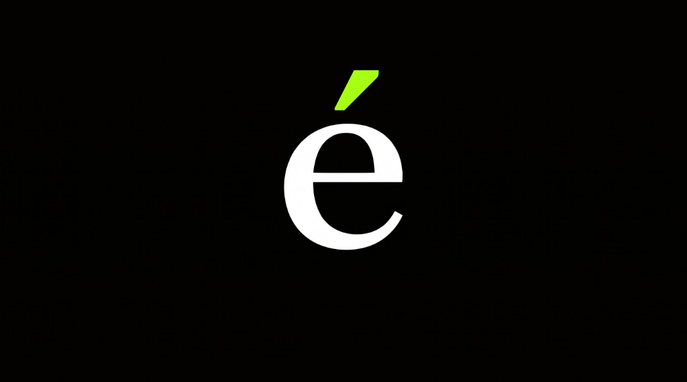

# Entree - Event Check-in & Management App

<p align="center">
  
  <br>
  <em>Seamless, elegant event guest management and QR check-in experience.</em>
</p>

---

## Features

- **Event Dashboard & Details**: Organize, manage, and monitor events in real-time with comprehensive attendee counts and schedules.
- **Fast QR Code Scanning**: Scan entry passes quickly using camera-based QR code verification via `mobile_scanner`.
- **Guest Management**: Search, invite, and track guest RSVP and check-in statuses effortlessly.
- **Invitation Sharing**: Generate and share stylish event passes and tickets directly to attendees.
- **Modern Adaptive Design**: Built with dynamic Light and Dark mode support, custom liquid-glass UI accents, and typography powered by Google Fonts.
- **Cross-Platform**: Tailored for Android, iOS, and Web.

---

## Tech Stack

- **Client App**: [Flutter](https://flutter.dev) (Dart SDK `^3.13.2`) with Light/Dark adaptive glass UI.
- **Backend Service**: Node.js & TypeScript 5.8 (Express 4) with PostgreSQL and offline sync queue.
- **Database**: PostgreSQL 16
- **Deployment**: Docker and Docker Compose
- **Event & Check-in Infrastructure**: Integrated with [MachineNova](https://machinenova.com) (`checkin-backend.machinenova.com`) Event & Roster APIs.
- **Barcode & QR Scanner**: `mobile_scanner`
- **Networking & Utilities**: `http`, `intl`, `pg`, `axios`

---

## Getting Started

### Prerequisites

- [Flutter SDK](https://docs.flutter.dev/get-started/install) installed on your system.
- Docker and Docker Compose installed.

### Installation & Run

1. **Clone the repository**:
   ```bash
   git clone git@github.com:KelvinMatheka-1/Entree.git
   cd Entree
   ```

2. **Run Backend and PostgreSQL with Docker Compose**:
   ```bash
   docker compose up -d
   ```

3. **Install Flutter dependencies & Run**:
   ```bash
   flutter pub get
   flutter run
   ```

4. **Build APK for Android**:
   ```bash
   flutter build apk --release
   ```

---

## License

This project is proprietary and developed by [Kelvin Matheka](https://github.com/KelvinMatheka-1). All rights reserved.
